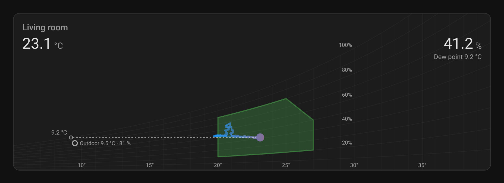
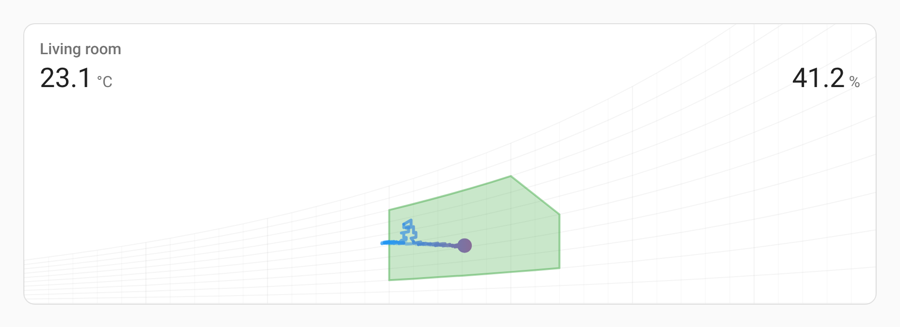
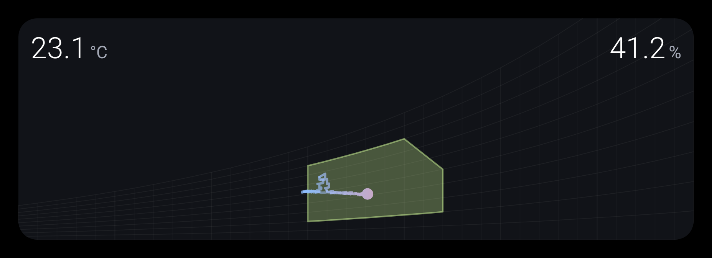

# Psychrochart

Psychrochart is a small Preact project for rendering a psychrometric chart
from temperature and relative humidity history. The main target is a Home
Assistant Lovelace custom card, with a local preview page backed by a mock
Home Assistant for development.

The chart plots temperature against humidity ratio (grams of water vapour per
kilogram of dry air), draws relative humidity curves, overlays a comfort zone,
and fades the historical path so the latest indoor state is easy to spot.

## Screenshots



Hovered, on Home Assistant's dark theme: the dew point, axis labels and outdoor
air appear over the chart.



On Home Assistant's light theme, with a name.



On the [Rounded dashboard](https://community.home-assistant.io/t/rounded-dashboard-guide/543043)
theme, with the variables from [Appearance](#appearance).

Try it live, with simulated sensors, on the
[project page](https://mathieudutour.github.io/psychrochart-home-assistant/).

## Features

- Home Assistant custom element: `psychro-chart-card`
- Configurable temperature and humidity entities
- Configurable Home Assistant history window, kept live through the
  `history/stream` websocket subscription
- Psychrometric calculations from the ASHRAE Handbook—Fundamentals equations,
  at the barometric pressure from a sensor or from your elevation
- A comfort zone set by the mean outdoor temperature of the last 30 days
- Local preview page with a mock Home Assistant
- Installable with HACS, with a visual editor, card picker suggestions and
  sizing for both masonry and sections dashboards

## Requirements

- Node.js 18 or newer
- npm
- Home Assistant 2023.2 or newer, if you want to use the generated Lovelace
  card (it relies on the `history/stream` websocket command)

## Development

Install dependencies:

```bash
npm install
```

Start the local preview:

```bash
npm run dev
```

Open [http://localhost:8000](http://localhost:8000). The page rebuilds and
reloads when you change a file.

The same page is published at
[mathieudutour.github.io/psychrochart-home-assistant](https://mathieudutour.github.io/psychrochart-home-assistant/)
from the `gh-pages` branch. The **Preview** workflow rebuilds it with
`npm run build:preview` and republishes it whenever `main` changes.

The preview mounts the real `psychro-chart-card` element with a mock Home
Assistant from `dev/mock-hass.ts`. The mock answers `history/stream` with a
simulated day of readings, including a few `unknown` and `unavailable`
states, then pushes live updates.

The same page is the project's landing page: it introduces the card,
explains how to read the chart and how to install it, and has a "Try it"
section. There you can switch between Home Assistant's default theme and the
Rounded theme, in light and dark, set a name, change the history window, the
temperature unit, the outdoor sensor's 30-day mean, the elevation and the
pressure sensor, and copy the configuration for those settings. Its
"Developer tools" push an `unknown` state, simulate a websocket reconnect and
count the open subscriptions.

Run the type checker and the unit tests:

```bash
npm run typecheck
npm test
```

## Build

Build the Home Assistant card bundle:

```bash
npm run build
```

This bundles `src/psychro-chart-card.tsx` with esbuild into
`dist/psychrochart-home-assistant.js`. The build output is not committed:
GitHub releases carry it.

## Home Assistant Installation

### With HACS

[](https://my.home-assistant.io/redirect/hacs_repository/?owner=mathieudutour&repository=psychrochart-home-assistant&category=plugin)

1. In HACS, open the menu in the top right corner and choose **Custom
   repositories**.
2. Add `https://github.com/mathieudutour/psychrochart-home-assistant` with the
   type **Dashboard**.
3. Find **Psychrometric Chart Card** in HACS and download it. HACS adds the
   dashboard resource for you.
4. Reload the browser.

### Manually

1. Download `psychrochart-home-assistant.js` from the
   [latest release](https://github.com/mathieudutour/psychrochart-home-assistant/releases/latest),
   or build it with `npm run build`.
2. Copy it into your Home Assistant `www` directory, for example
   `/config/www/psychrochart-home-assistant.js`.
3. Add it as a dashboard resource (**Settings → Dashboards → ⋮ → Resources**):

   ```yaml
   url: /local/psychrochart-home-assistant.js
   type: module
   ```

### Adding the card

Edit a dashboard, choose **Add card** and pick **Psychrometric Chart**. The
card starts with a temperature and a humidity sensor from the same device, if
you have one, and every option can be set in the visual editor. On Home
Assistant 2026.6 or newer, the card is also suggested when you pick a
temperature or humidity sensor that has a partner on the same device.

In YAML:

```yaml
type: custom:psychro-chart-card
temperature: sensor.living_room_temperature
humidity: sensor.living_room_humidity
outdoorTemperature: sensor.outdoor_temperature
outdoorHumidity: sensor.outdoor_humidity
pressure: sensor.barometric_pressure
hours: 24
```

In a sections dashboard the card takes the full width and three rows by
default, and can be resized down to half the width and two rows.

## Card Configuration

| Option | Required | Description |
| --- | --- | --- |
| `name` | No | Shown above the readings, like the name of Home Assistant's built-in cards. |
| `temperature` | Yes | Home Assistant entity ID for the temperature sensor, in °C, °F or K. The readout shows the sensor's own value and unit. |
| `humidity` | Yes | Home Assistant entity ID for the relative humidity sensor. Values are expected as percent RH. |
| `hours` | No | Number of hours of Home Assistant history to load. Defaults to `24`. |
| `double_tap_action` | No | What a double tap, or double click, on the temperature or the humidity does. Defaults to opening that sensor's details. Any [Home Assistant action](https://www.home-assistant.io/dashboards/actions/), or `none`. |
| `hold_action` | No | What holding anywhere on the card does. Defaults to `none`. |
| `outdoorTemperature` | No | Outdoor temperature sensor. Its mean over the last 30 days positions the comfort zone. It needs long-term statistics, which Home Assistant keeps for sensors with a `state_class` of `measurement`. Without it, the comfort zone assumes a mean of 19 °C. Its current reading is also shown with the details. |
| `outdoorHumidity` | No | Outdoor humidity sensor. With `outdoorTemperature`, the details show the outdoor air as a point on the chart; without it, as a line at the outdoor temperature. |
| `pressure` | No | Barometric pressure sensor, in any unit Home Assistant uses (hPa, mbar, kPa, Pa, bar, inHg, mmHg or psi). It must report station pressure, not pressure adjusted to sea level. Without it, or when its reading is not usable, the card uses the standard atmosphere at the elevation set in Home Assistant. |

The card subscribes to Home Assistant's `history/stream` websocket command for
the temperature and humidity entities. Home Assistant sends the history for the
window once, then pushes each new state, so the card never re-downloads the
window. States that are not numbers, such as `unknown` and `unavailable`, are
skipped. Each series carries its last value forward, and a point is plotted
wherever both a temperature and a humidity are known. Points older than the
window are dropped, both when new states arrive and once a minute. After a
websocket reconnect the card starts a fresh subscription for the current
window.

### Appearance

The card follows your Home Assistant theme: it uses the theme's card
background, border and radius, its text colours and type scale, and its
green, blue and red for the comfort zone and the trail, like the built-in
cards. Every choice can be changed with these variables, in a theme or for
one card with [card-mod](https://github.com/thomasloven/lovelace-card-mod):

| Variable | Default | Sets |
| --- | --- | --- |
| `--psychrochart-comfort-zone-color` | `--green-color` | The comfort zone. |
| `--psychrochart-cold-color` | `--blue-color` | The cool end of the trail and point gradient. |
| `--psychrochart-warm-color` | `--red-color` | The warm end of the gradient. |
| `--psychrochart-grid-color` | `--primary-text-color` | The relative humidity and temperature lines, drawn faintly. |
| `--psychrochart-value-font-size` | `--ha-font-size-3xl` (28px) | The temperature and humidity values. |
| `--psychrochart-value-font-weight` | `--ha-font-weight-normal` (400) | The values. |
| `--psychrochart-unit-font-size` | `--ha-font-size-l` (16px) | The units next to the values. |
| `--psychrochart-unit-color` | `--secondary-text-color` | The units and the dew point line. |
| `--psychrochart-name-font-size` | `--ha-font-size-l` (16px) | The name, when set. |
| `--psychrochart-readout-padding` | `16px 16px 0` | Space around the readout. |

#### Rounded dashboard

For the larger, lighter readout of the
[Rounded dashboard](https://community.home-assistant.io/t/rounded-dashboard-guide/543043),
add these variables to the theme in `Rounded.yaml`. The comfort zone and
the gradient already pick up Rounded's colours, as the theme sets
`green-color`, `blue-color` and `red-color`.

```yaml
Rounded:
  # ...the theme's existing variables...
  psychrochart-value-font-size: 2.4em
  psychrochart-value-font-weight: 300
  psychrochart-unit-font-size: 1.4em
  psychrochart-unit-color: var(--contrast13)
  psychrochart-readout-padding: 1em 16px 0
```

To style a single card instead, set the same variables with card-mod:

```yaml
type: custom:psychro-chart-card
temperature: sensor.living_room_temperature
humidity: sensor.living_room_humidity
card_mod:
  style: |
    ha-card {
      --psychrochart-value-font-size: 2.4em;
      --psychrochart-value-font-weight: 300;
    }
```

### Interactions

- **Double tap or double click** on the temperature or the humidity opens
  that sensor's details in Home Assistant. Change it with
  `double_tap_action`: a `more-info` action without an `entity` opens the
  sensor that was tapped.
- **Hold** anywhere on the card does nothing by default. Set `hold_action`
  to any Home Assistant action, for example:

  ```yaml
  hold_action:
    action: navigate
    navigation_path: /lovelace/climate
  ```

- **Tap** shows or hides the details on touch screens, which have no hover,
  so it is not configurable. A tap on a reading waits a quarter of a second
  to tell it from a double tap.
- With the keyboard, Tab moves to the card and Enter shows or hides the
  details.

Actions other than `more-info` are handed to Home Assistant as built-in
cards do, so confirmations and every action type work the same way.

### Languages

Words Home Assistant already translates, such as "Dew point", the loading
messages, "Entity not found" and the editor's generic labels, come from Home
Assistant, in every language it supports. The card's own words, such as
"Outdoor", the editor's sensor labels and its help text, are translated into
English, French, German, Spanish and Dutch, and fall back to English in
other languages. To add one, copy the `en` block in `src/translations.ts`,
translate it and add it to `STRINGS`; the tests check that no string is
missing.

### Readings and states

Values are formatted like the built-in cards: in your language and number
format, with each sensor's display precision from its entity settings.
While the history loads, the current values show right away with a loading
message. When a sensor is unavailable, the readout says so, the latest
point dims and the dew point is hidden. A mistyped entity ID shows Home
Assistant's "Entity not found" warning.

### Details on hover

To keep the card calm, some details only appear while the pointer is over
it. On a touch screen, which has no hover, a tap shows them and another tap
hides them.

- The dew point: a dashed line from the latest reading to where its
  moisture content would condense, and a line under the humidity readout.
  It is computed from the same saturation pressure as the chart.
- Temperature labels along the bottom, and labels on the 20 to 100%
  relative humidity curves. Cards narrower than 480 px skip the humidity
  labels, which the readout would cover.
- The outdoor air, when `outdoorTemperature` is set.

Readings below the chart's 5 °C edge, such as a dew point in a dry winter or
cold outdoor air, are shown at the edge with an arrow.

### Units

The card reads the temperature sensor's unit from its `unit_of_measurement`,
or from Home Assistant's unit system when the sensor has none, and converts
readings to °C for the chart. The outdoor mean is requested in °C from Home
Assistant, which converts it, so the outdoor sensor can use any unit too.

History is stored in the unit a sensor used at the time. After you change a
sensor's unit, the trail mixes old and new readings until the old ones leave
the history window.

### Comfort Zone

The comfort zone is the one from the Givoni bioclimatic chart, as drawn by
[Andrew Marsh's psychrometric chart](https://andrewmarsh.com/software/psychro-chart-web/).
Its lowest temperature is Auliciems' neutral temperature,
`17.6 + 0.31 × mean outdoor temperature`, less 3.5 °C. The zone is 7 °C wide,
lies between 20% and 80% relative humidity and below 16 g/kg, and its warmest
part is limited to 50% relative humidity. Because the neutral temperature
depends on the outdoor climate, the zone moves with the seasons rather than
with the indoor reading.

When the mean outdoor temperature is below 10 °C, the winter zone applies: it
reaches 2 °C lower and runs 2 °C further along the 80% line, for warmer
clothing. 10 °C is where ASHRAE 55's adaptive comfort model stops applying,
because buildings are heated. Following the outdoor climate rather than the
calendar keeps this right in both hemispheres. Without an outdoor sensor, the
mean is taken as 19 °C, so the winter zone does not apply.

The mean outdoor temperature comes from Home Assistant's long-term statistics
(`recorder/statistic_during_period`, a 30-day rolling window, converted to °C)
and is refreshed hourly.

### Air Pressure

The humidity ratio of air at a given temperature and relative humidity depends
on the air pressure: it is about 6% higher at 500 m and 20% higher at 1500 m
than at sea level. The card uses the `pressure` sensor when one is configured,
otherwise the ASHRAE standard atmosphere at Home Assistant's elevation.

Many weather stations and integrations report pressure adjusted to sea level.
That value is wrong for psychrometrics away from the coast, so only use a
sensor that reports the actual pressure where you are.

## Project Structure

```text
src/
  psychro-chart-card.tsx  Home Assistant custom card entry point
  setup.ts                Card picker, stub config and visual editor form
  history.ts              History stream subscription, merging and pruning
  environment.ts          Air pressure and mean outdoor temperature
  app/
    chart.tsx             SVG psychrometric chart
    states.tsx            Current temperature and humidity readout
    physic.ts             Psychrometric formulas (ASHRAE Fundamentals, ch. 1)
    getComfortZone.ts     Comfort-zone and relative-humidity curve helpers
    geometry.ts           Rounding helper
dev/
  index.html              Local preview page
  preview.ts              Mounts the card with the mock
  mock-hass.ts            Mock Home Assistant states, history and statistics
test/
  history.test.ts         History stream logic
  physic.test.ts          Psychrometrics, against ASHRAE tables and PsychroLib
  comfort.test.ts         Comfort zone and relative humidity curves
  environment.test.ts     Pressure and mean outdoor temperature
  setup.test.ts           Card picker and editor helpers
scripts/
  build.mjs               Builds dist/psychrochart-home-assistant.js
  build-preview.mjs       Builds the preview page into site/
  test.mjs                Compiles test/*.test.ts into .test-build/ and runs them
.github/workflows/
  ci.yml                  Type-check, test and build on every push and PR
  release.yml             Attaches the build to each published release
  preview.yml             Publishes the preview page to gh-pages
  validate.yml            HACS validation
hacs.json                 HACS manifest
```

## Scripts

| Command | Description |
| --- | --- |
| `npm run dev` | Serve the local preview on port 8000 and rebuild on change. |
| `npm run build` | Bundle the card to `dist/psychrochart-home-assistant.js`. |
| `npm run build:preview` | Build the preview page as a static site in `site/`. |
| `npm run typecheck` | Type-check the project with TypeScript. |
| `npm test` | Run the unit tests with Node's test runner. |

## Releasing

1. Publish a GitHub release with a version tag such as `v0.2.0`.
2. The **Release** workflow tests the code, builds the card with that version
   and attaches `psychrochart-home-assistant.js` to the release.
3. HACS offers the new version to users. The card logs its version in the
   browser console when it loads.

## Notes

- The chart currently spans 5 °C to 40 °C (41 °F to 104 °F) on the
  temperature axis.
- Humidity ratio is plotted from 0 to about 35 g/kg.
- Relative humidity guide curves are drawn from 0 percent to 100 percent in 10
  percent increments.

## License

[MIT](LICENSE)
